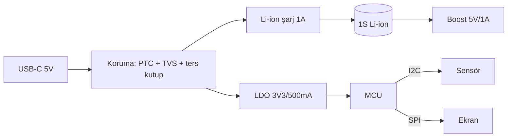

# 01 — Gereksinim ve Mimari (Requirements & Architecture)

## 1. Gereksinim Toplama — Sorulacak Sorular

Bilinmeyenleri **tek seferde** sor. Makul varsayılanı olanları sorma; varsayım olarak yaz.

| Başlık | Soru |
|---|---|
| Amaç | Kart ne yapacak? Hangi ürünün parçası? |
| Giriş gücü | Kaynak ne (USB-C, adaptör 12/24 V, pil)? Gerilim aralığı ve en kötü durum (transient, ters bağlama)? |
| Çıkış/yük | Hangi raylar (5 V, 3V3...), her birinden kaç A? Motor/röle/LED gibi büyük yük var mı? |
| Arayüzler | Hangi sensör, ekran, konnektör? Kablo uzunlukları? Harici dünyaya açık pinler (ESD riski)? |
| Mekanik | Kart ölçüsü, montaj deliği, kutu, konnektör konumları, maksimum parça yüksekliği |
| Üretim | Adet, JLC dizgi mi, elle lehim mi, tek yüz dizgi mi? Bütçe? |
| Ortam | Sıcaklık, titreşim, nem, araç/endüstriyel ortam? |
| Programlama/test | SWD/UART/USB? Test noktası ve fikstür ihtiyacı? |
| Elde olan parçalar | Stokta kullanmak istenen parça var mı? |

## 2. Blok Diyagram

Şematiğe başlamadan önce metin veya Mermaid olarak blok diyagram çiz. Her ok üzerine sinyal veya ray adını yaz.

## 3. Güç Ağacı ve Güç Bütçesi (Power Tree & Budget)

Her rayı tabloya dök. Toplam akıma **%30 pay** ekle.

| Ray | Kaynak | Regülatör | Yükler | Tipik / Tepe akım | Kayıp / Isı |
|---|---|---|---|---|---|
| 3V3 | 5V | LDO ME6211 | MCU 80 mA, sensör 5 mA, Wi-Fi tepe 350 mA | 120 / 450 mA | (5−3.3)×0.12 = 0.2 W |

Kurallar:
- LDO kaybı = (Vin − Vout) × I. **>0.5 W ise** SOT-23 yetmez; SOT-223/DFN ve bakır alan gerekir ya da buck kullanılmalı (`pcb_calc.py ldo`).
- Fark >3 V ve akım >300 mA ise buck tercih et.
- Wi-Fi/BLE modülleri, motorlar ve servolar için **tepe akımına** göre tasarla.
- Açılış sırası (power sequencing) ve inrush akımı gerekiyor mu, kontrol et.

## 4. Pin/GPIO Tablosu (Pin Map)

MCU'lu her projede şematikten **önce** pin tablosu çıkar:

| MCU pin | Fonksiyon | Yön | Net adı | Not (strapping, 5V-tolerant, ADC, PWM, boot) |
|---|---|---|---|---|

Kurallar:
- Önce donanım çevre birimlerinin sabit pinlerini (USB, SWD, kristal, I2C/SPI donanım pinleri) yerleştir, sonra GPIO'ları.
- Strapping/boot pinlerini çıkış olarak kullanma ya da açılış seviyesini garanti et.
- Pinleri PCB'de kısa yol verecek şekilde seç (yerleşimle beraber düşün). İlk PCB yerleşiminden sonra pin tablosunu tekrar optimize et ("pin swap").
- En az 1–2 yedek GPIO'yu test noktasına çıkar.

## 5. Arayüz Listesi

| Arayüz | Uç birimler | Hız | Kablo/mesafe | Pull-up/terminasyon | ESD |
|---|---|---|---|---|---|

## 6. Alan Bütçesi (Area Budget) — sabit ölçülü kartlarda zorunlu

Montaj (tek/çift yüz) seçeneği sunmadan **önce** hesapla:
1. Kullanılabilir alan = kart alanı − konnektör/header/montaj deliği yasak bölgeleri (ör. Nano: header sıraları arası ≈ 12.8 mm × 43 mm).
2. Her parçanın **pad + gövde** dikdörtgenini topla (EasyEDA courtyard'ı yalnızca gövdeyi kapsar, pad'leri ekle).
3. Σ alan × 1.5 (routing + boşluk payı) ≤ kullanılabilir alan → tek yüz mümkün. Değilse çift yüz, daha küçük paket ya da daha büyük kart seçeneklerini rakamlarla sun.
4. Uzun parçalar için tek eksen kontrolü de yap: büyük parçaların yükseklikleri toplamı kart uzunluğunu aşıyor mu?

## 7. Mimari Kapı (Gate) — Kontrol

- [ ] Gereksinim tablosu kullanıcıyla teyit edildi
- [ ] Blok diyagram var, her blok bir şematik sayfasına karşılık geliyor
- [ ] Güç bütçesi %30 payla hesaplandı; regülatör ısıl hesabı yapıldı
- [ ] Pin tablosu var; boot/strapping pinleri kontrol edildi
- [ ] Harici dünyaya açık her pin için koruma (ESD/seri direnç/TVS) kararı verildi
- [ ] Mekanik kısıtlar (ölçü, delik, konnektör yerleri) belli ya da varsayım olarak yazıldı
- [ ] Sabit ölçülü kartta alan bütçesi (§6) hesaplandı; tek/çift yüz kararı rakamla verildi
